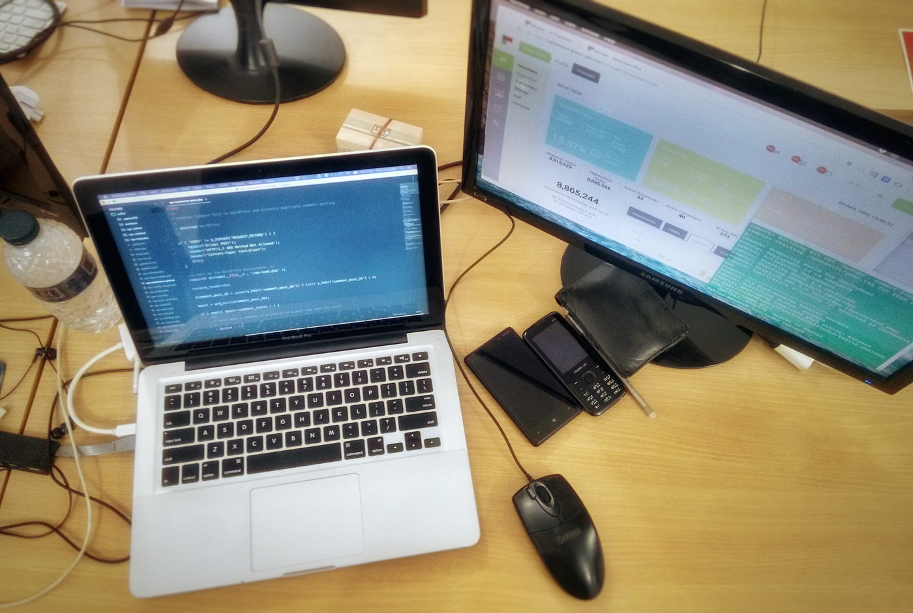
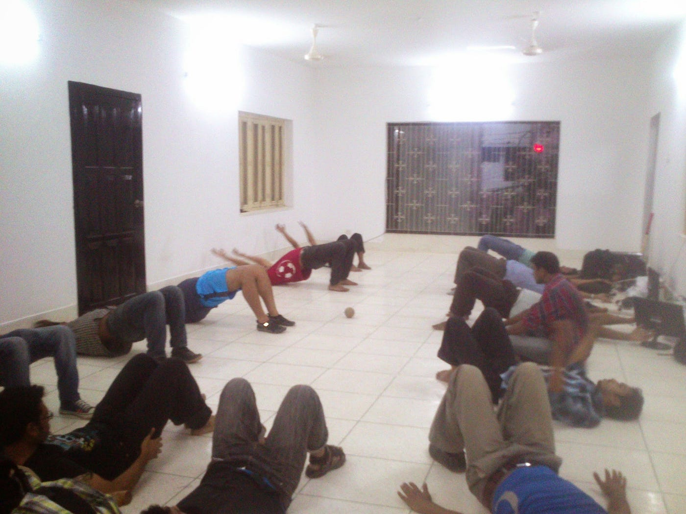

G&R এ যোগ দেয়াটা একটু অন্যরকমই ছিল। ManGoes Mobile-এর শেষ দিকে ন্যাশ যখন একদিন বললো যে ManGoes টিম G&R এর সাথে যোগ দিচ্ছে। কিছুদিন আগে ঘটে যাওয়া কোনো এক ঘটনার কারণে উচ্ছাসিত হওয়াটা তখন আমার দূরতম চিন্তায়ও ছিল না। “ধুর!!! আবার চাকরি খুঁজতে হবে”, ছিল আমার প্রাথমিক রিএকশন। পরে অবশ্য ঘটনাচক্রে দেখা গেলো G&R-এ যোগ দেয়াটা খুব একটা খারাপ হবে না।

জিতু ভাই আর মিলন ভাইয়ের সাথে প্রথম পরিচয়টা তার কিছুদিন পরই। একদিন অফিস আর আমাদের সাথে দেখা করার করার জন্য উনারাই আসলেন ManGoes-এর অফিসে। প্রথম দেখাই মনে হয়েছিল মিলন ভাই লোকটা অনেক গোছানো, প্রচন্ড এটেনশন টু ডিটেইল আর পারফেকশনিস্ট। সামান্য দিন-তারিখ বা এড নেটওয়ার্কের জটিল সংখ্যাগুলোও উনি চিন্তা করে সঠিকভাবে বলার চেষ্টা করছেন। অন্য দিকে জিতু ভাই লোকটা একটু অগোছালো গোছের কিন্তু চুলভর্তি বিশাল মাথাটার ভিতর যে কি ধারালো এক মগজ কাজ করছে তা খুব সহজেই বোঝা যাচ্ছিল।

প্রথম দিন থেকেই G&R অনেক বন্ধুভাবাপন্ন ছিল। পরবর্তীতে যে তা পরিবারে রূপ নিতে যাচ্ছে তা তখন আমি ঘুণাক্ষরেও চিন্তা করিনি। চাইপ্প্যা সাইফ ভাই, হিরো জুয়েল ভাই, কক্সবাজার সমুদ্র ভাইদের সাথে পরিচিত হওয়াটা ছিল বেশ মজার অভিজ্ঞতা। আর কাঁচের জারটাকে নিয়ে বেশি কিছু নাই বললাম। অফিসে ভুল-ভাল ইংরেজি বললে বা কলিগের সাথে তুই-তুকারি করলে যেখানে ৫ টাকা দেয়া লাগতো।

*G&R এর শুরুর দিনগুলোতে ডিজাইন করা একটি ওয়ালপেপার*

## একটি নতুন পরিচ্ছেদের সূচনা

G&R-এর CEO হওয়ার পর ন্যাশ প্রথম যে কাজগুলো করল তার মধ্যে একটি হল আমাদের নতুন অফিসে যাওয়া। বনানী বিদ্যানিকেতনের উল্টা পাশে হোটেল ডি ক্যাসেল-এর (মতান্তরে চাসলে, এ আরেক বিশাল ঘটনা 🤣) পাশে প্রায় ৩৬০০ স্কয়ার ফুটের বিশাল (আমাদের তুলনায়) অফিস।

*নতুন অফিসের প্রথম দিন। চেয়ার-টেবিল তখনও এসে পৌঁছায়নি। কিন্তু তাই বলে তো আর অলস বসে থাকা যায় না।*

নতুন অফিস, তখনও না আসা চেয়ার-টেবিল, আর এক ঝাঁক নতুন মানুষ - সব মিলিয়ে মনে হচ্ছিল সামনে লম্বা একটা পথ পড়ে আছে। সেই পথে অফিসের বারান্দায়, কাজের ফাঁকে আর ছুটির পরে কত সন্ধ্যা যে একসাথে কেটে যাবে, তখনও তা জানতাম না। সেই সন্ধ্যাগুলোর গল্প থাকছে পরের পর্বে।
