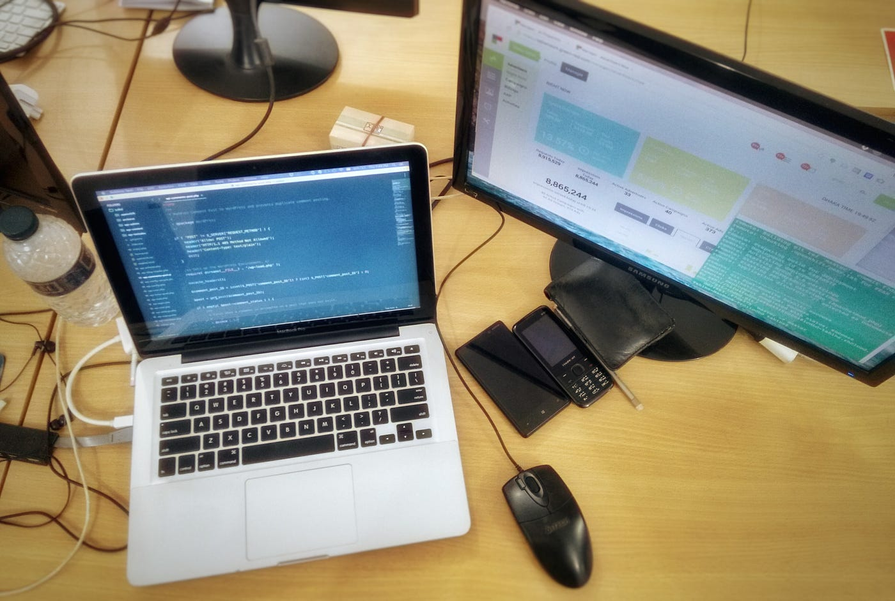

G&R এ যোগ দেয়াটা একটু অন্যরকমই ছিল। ManGoes Mobile-এর শেষ দিকে ন্যাশ যখন একদিন বললো যে ManGoes টিম G&R এর সাথে যোগ দিচ্ছে। কিছুদিন আগে ঘটে যাওয়া কোনো এক ঘটনার কারণে উচ্ছাসিত হওয়াটা তখন আমার দূরতম চিন্তায়ও ছিল না। “ধুর!!! আবার চাকরি খুঁজতে হবে”, ছিল আমার প্রাথমিক রিএকশন। পরে অবশ্য ঘটনাচক্রে দেখা গেলো G&R-এ যোগ দেয়াটা খুব একটা খারাপ হবে না।

জিতু ভাই আর মিলন ভাইয়ের সাথে প্রথম পরিচয়টা তার কিছুদিন পরই। একদিন অফিস আর আমাদের সাথে দেখা করার করার জন্য উনারাই আসলেন ManGoes-এর অফিসে। প্রথম দেখাই মনে হয়েছিল মিলন ভাই লোকটা অনেক গোছানো, প্রচন্ড এটেনশন টু ডিটেইল আর পারফেকশনিস্ট। সামান্য দিন-তারিখ বা এড নেটওয়ার্কের জটিল সংখ্যাগুলোও উনি চিন্তা করে সঠিকভাবে বলার চেষ্টা করছেন। অন্য দিকে জিতু ভাই লোকটা একটু অগোছালো গোছের কিন্তু চুলভর্তি বিশাল মাথাটার ভিতর যে কি ধারালো এক মগজ কাজ করছে তা খুব সহজেই বোঝা যাচ্ছিল।

প্রথম দিন থেকেই G&R অনেক বন্ধুভাবাপন্ন ছিল। পরবর্তীতে যে তা পরিবারে রূপ নিতে যাচ্ছে তা তখন আমি ঘুণাক্ষরেও চিন্তা করিনি। চাইপ্প্যা সাইফ ভাই, হিরো জুয়েল ভাই, কক্সবাজার সমুদ্র ভাইদের সাথে পরিচিত হওয়াটা ছিল বেশ মজার অভিজ্ঞতা। আর কাঁচের জারটাকে নিয়ে বেশি কিছু নাই বললাম। অফিসে ভুল-ভাল ইংরেজি বললে বা কলিগের সাথে তুই-তুকারি করলে যেখানে ৫ টাকা দেয়া লাগতো। 

*G&R এর শুরুর দিনগুলোতে ডিজাইন করা একটি ওয়ালপেপার*

## একটি নতুন পরিচ্ছেদের সূচনা 

G&R-এর CEO হওয়ার পর ন্যাশ প্রথম যে কাজগুলো করল তার মধ্যে একটি হল আমাদের নতুন অফিসে যাওয়া। বনানী বিদ্যানিকেতনের উল্টা পাশে হোটেল ডি ক্যাসেল-এর (মতান্তরে চাসলে, এ আরেক বিশাল ঘটনা 🤣) পাশে প্রায় ৩৬০০ স্কয়ার ফুটের বিশাল (আমাদের তুলনায়) অফিস। 

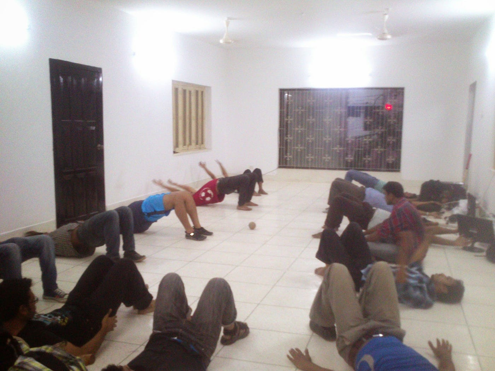

*নতুন অফিসের প্রথম দিন। চেয়ার-টেবিল তখনও এসে পৌঁছায়নি। কিন্তু তাই বলে তো আর অলস বসে থাকা যায় না।*

  

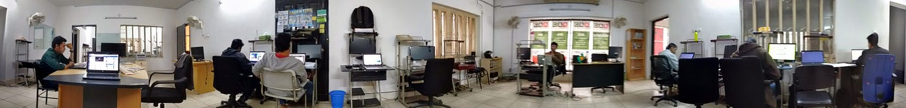

## G&R এড নেটওয়ার্ক ৩.০

এড নেটওয়ার্ক জিনিসটা মানুষকে সহজে বোঝানো কঠিন। অল্প কথায় এড নেটওয়ার্ক একধরণের সিস্টেম যা বিজ্ঞাপনদাতাদের সাথে ওয়েবসাইট বা মোবাইল এপ্লিকেশনগুলোকে যুক্ত করে। ব্যাপারটা একটু একটু বুঝে নেয়ার সাথে সাথেই আমরা শুরু করি এড নেটওয়ার্কের নতুন ভার্সনের কাজ। ৩.০। G&R এর ওয়েবসাইটকে নতুন করে ঢেলে সাজানো হয় ওয়ার্ডপ্রেসে। এসময়টাতে ফারুক ভাইয়ের সাহায্য ছিল উল্লেখ করার মত। 

ওয়েবসাইট ছাড়াও বিজ্ঞাপনদাতা, পাবলিশার আর একাউন্ট ম্যানেজারদের ড্যাশবোর্ডটাকেও সাজানো হয় নতুন করে। মিলন ভাইয়ের ডিজাইন ও পরিকল্পনা আর ন্যাশের তত্ত্বাবধানে 

১০ অগাস্ট ২০১৪ তে রিলিজ হয় 

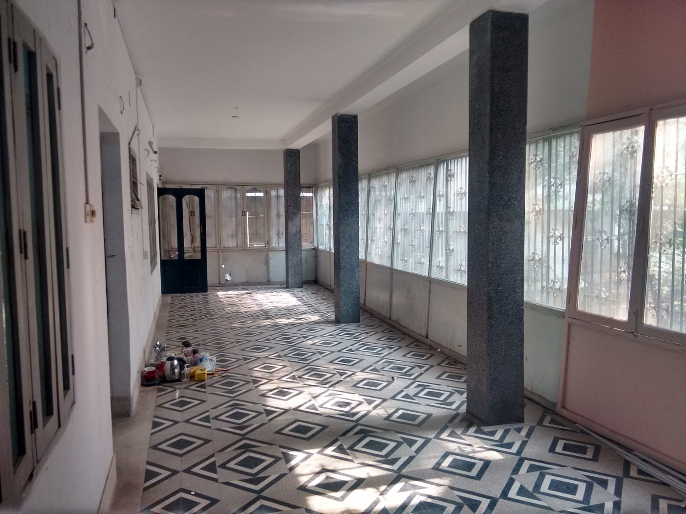

*অফিসের বারান্দা ছিল ক্রিকেট খেলার মোক্ষম জায়গা*

  

  

  

  

  

  

  

  

## অন্ধকারাচ্ছন্ন সময় 

  

## মিলন ভাই, আবার নতুন অফিস 

অগাস্ট ২০১৫

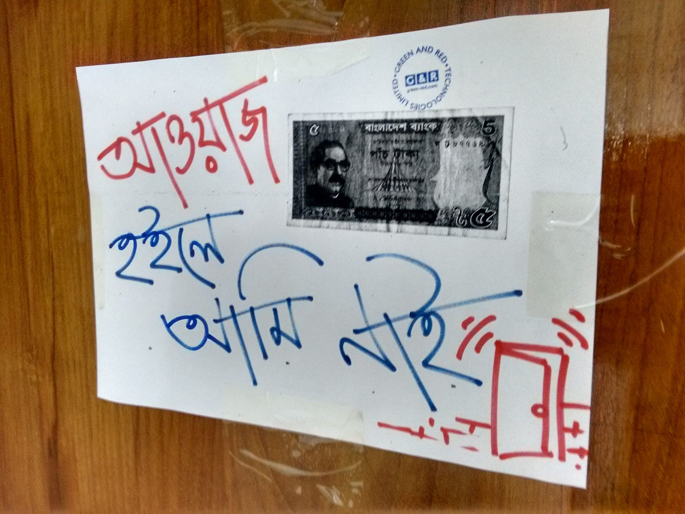

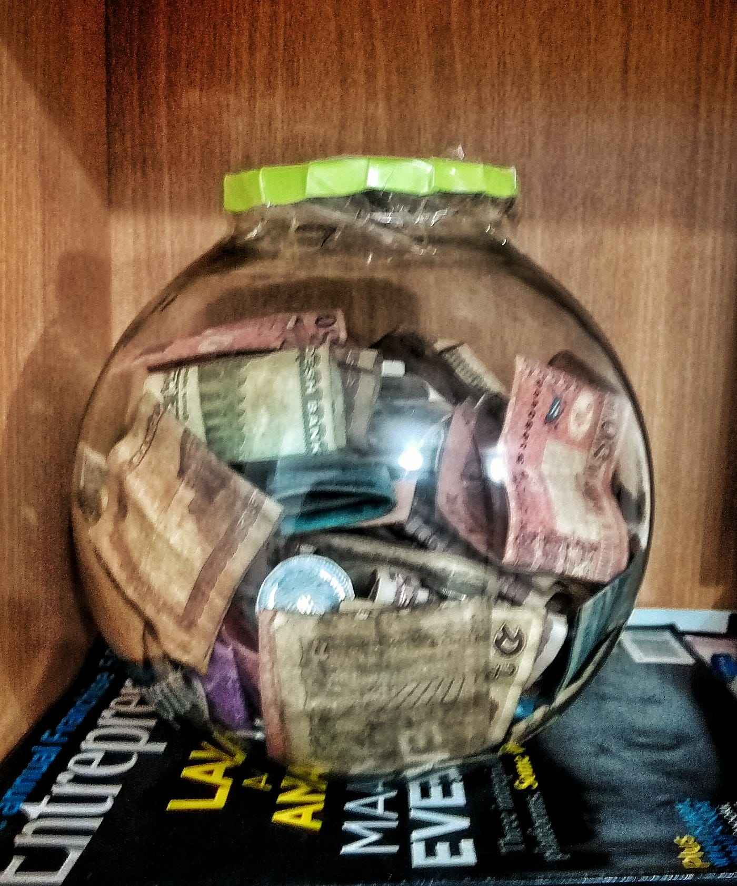

  

  

  

সবাই একসাথে করা লাঞ্চগুলোর স্বাদ হতো অন্যরকম।

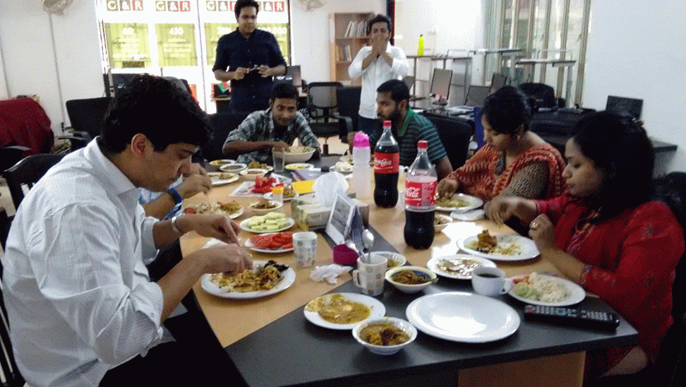

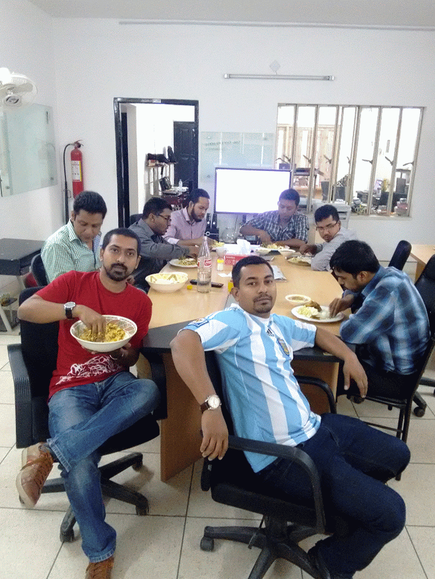

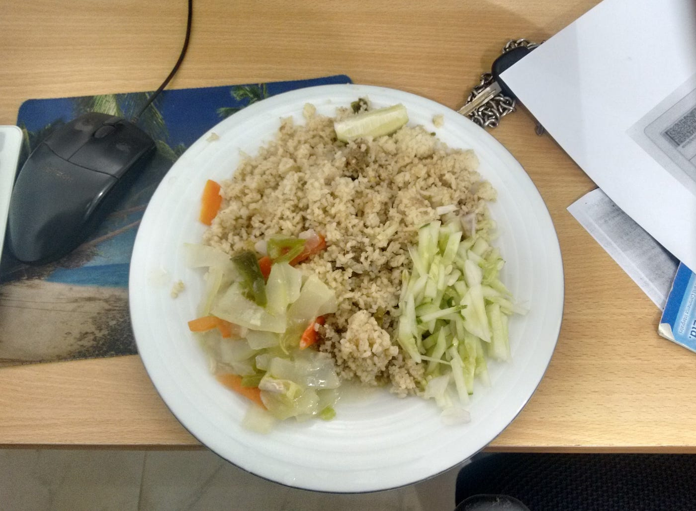

বিস্ট ইয়ার 

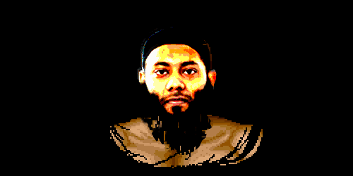

  

  

  

  

  

  

ক্রিকেট 

প্রথম খেলা Dec 6, 2013, we won some, lose some, but got the most important trophy, team spirit.

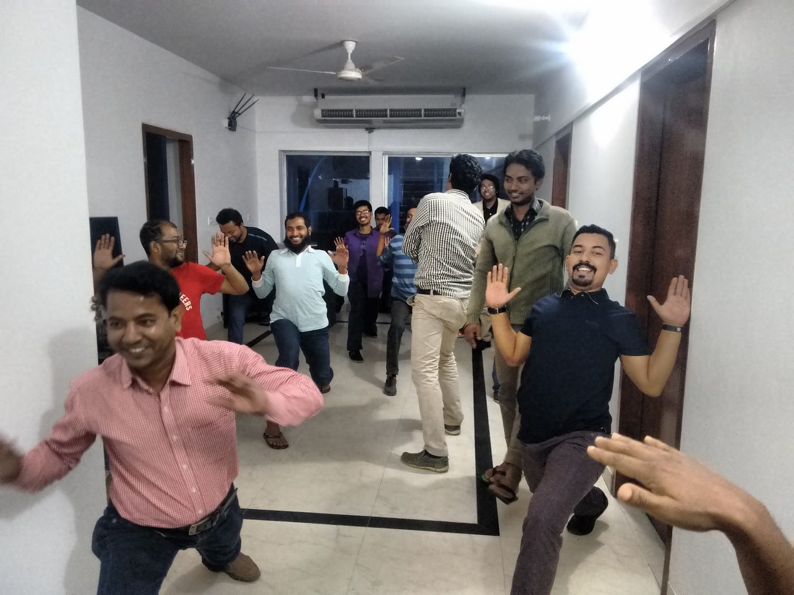

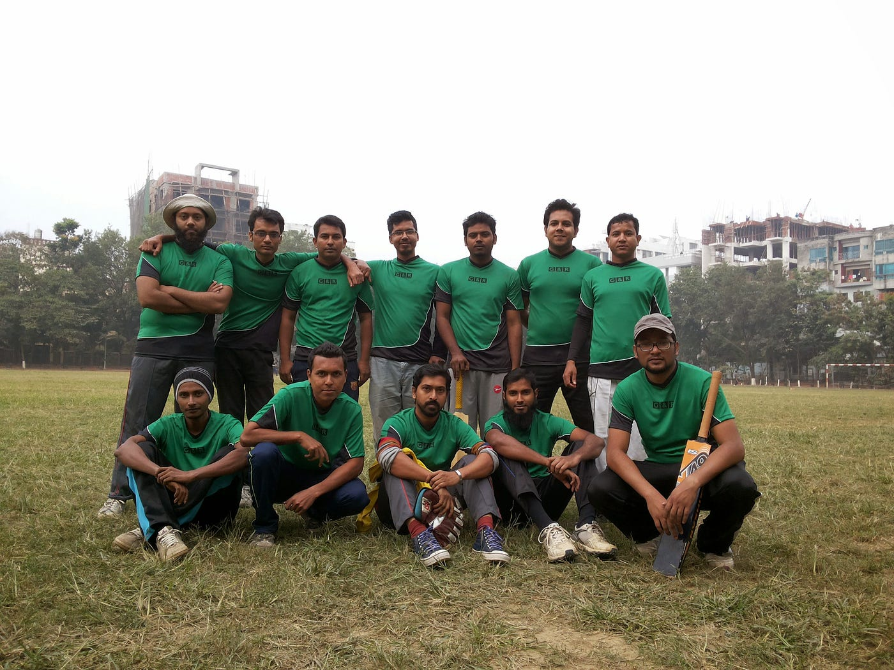

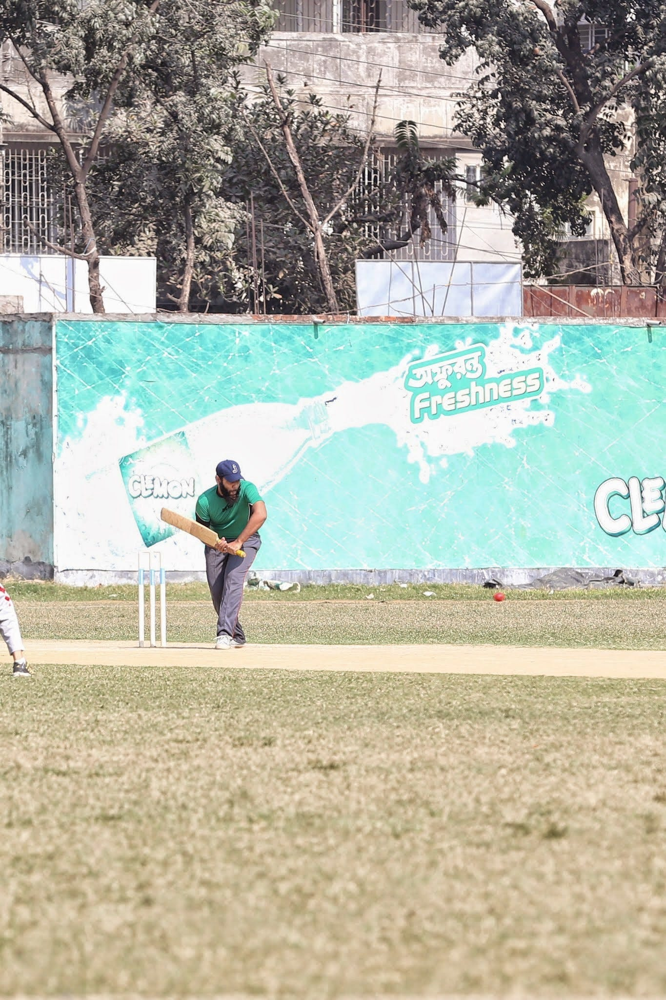

স্টার্টআপ এর চ্যালেঞ্জ গুলো

  

সন্ধ্যা একটা অদ্ভুত সময়। প্রকৃতি তার রূপ বদলায়। আলোকে খেয়ে নেয় অন্ধকার। এমন অনেক সন্ধ্যাই কেটেছে
