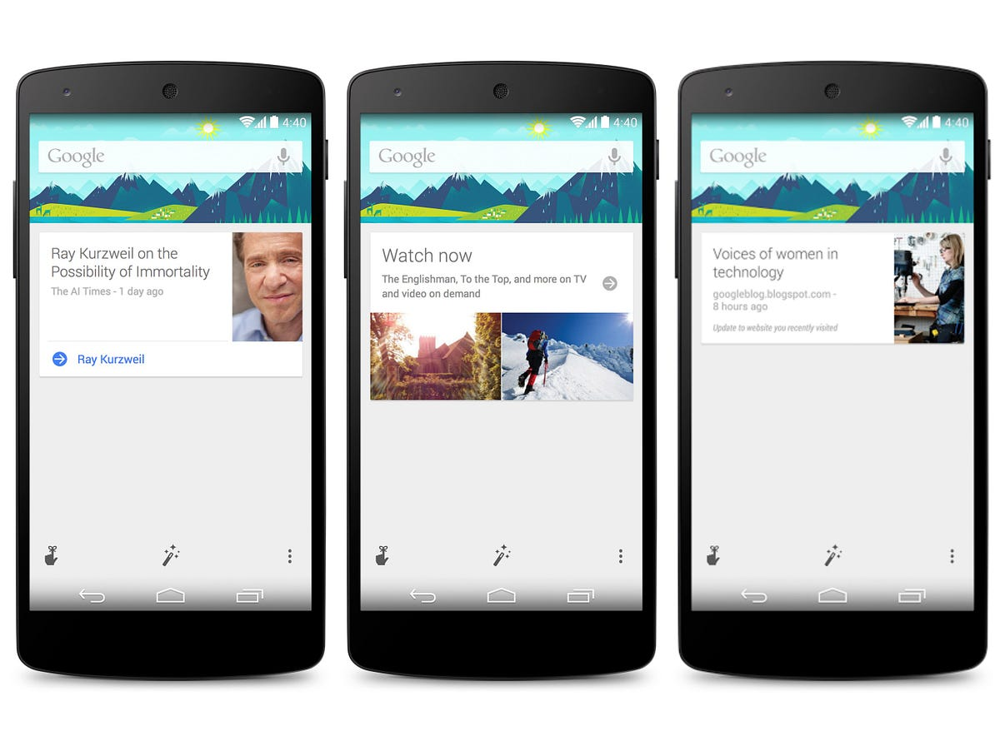

— without factory reset or root

Enable Google Now in non-supported countries (without factory reset or root):

1.  Turn on Developer Options: Settings > About Phone > tap ‘Build Number’ several times until you are notified that you are a developer
2.  Allow Mock Locations: Settings > Developer Options > check ‘Allow mock locations’
3.  Download and install ‘ Fake GPS location’ from Google Play
4.  Set a fake location to somewhere where Google Now is enabled (ex. London): open ‘Fake GPS’ > click on the search button > type the location > click OK > click ‘Set location’
5.  Make sure that the fake location is started when the device is switched on: open ‘Fake GPS’ > go to settings > check ‘Start on boot’
6.  Switch off your phone
7.  Take out your SIM
8.  Switch on your phone
9.  Deactivate Android Device Manager: Google Settings > Android Device Manager > uncheck both options
10.  Disable Google Play Services: Settings > Apps > All > Google Play Services > Disable
11.  Disconnect your account: Settings > Google (under subtitle ‘Accounts’) > Search > Accounts & Privacy > Google Account > Sign out
12.  Connect your account: Settings > Google (under subtitle ‘Accounts’) > Search > Accounts & Privacy > Google Account > click on your email address. If you get Network Error, you could try clearing the data of the search app and clearing any unnecessary permissions from the Google Settings and then try again

You might need to deactivate and then activate Google Play Services more than once.

13.  Accept Google Now: (if not asked automatically) Settings > Google (under subtitle ‘Accounts’) > Search > turn on Google Now
14.  Enable Google Play Services: Settings > Apps > Disabled > Google Play Services > Enable
15.  Stop fake GPS: open ‘Fake GPS’ > click ‘Stop’
16.  Uninstall ‘Fake GPS’ if you want
17.  Activate Android Device Manager: Google Settings > Android Device Manager > check both options
18.  Switch off your phone
19.  Put your SIM in
20.  Switch on your phone

Have FUN
