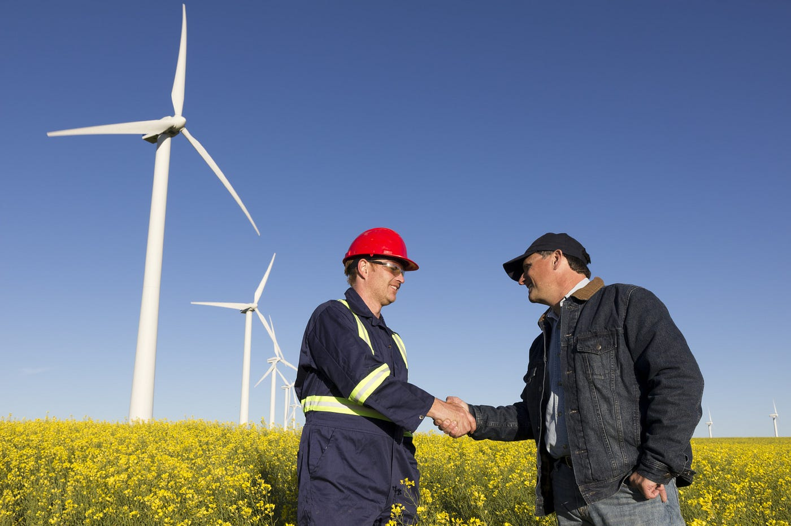

## একটি (প্রায়) শিক্ষামূলক গল্প

এক দেশে ৫০ জন ইঞ্জিনিয়ার আর ৫০ জন কৃষক ছিল। ইঞ্জিনিয়ার-রা তাদের গবেষণার মাধ্যমে বিভিন্ন যন্ত্রপাতি আবিস্কার করতেন যা কৃষকদের অনেক কাজকেই সহজ করে দিত। অন্যদিকে কৃষকরা তাদের দিন-রাত ২৪ ঘন্টা পরিশ্রমে যে ফসল ফলাতেন তা তাদের ও ওই ইঞ্জিনিয়ারদের খাবারের চাহিদা পূরণ করত। এভাবে তাদের দিনগুলো খুব ভালই কেটে যাচ্ছিল, যতদিন না পর্যন্ত …

ওই দেশে এক কম্পিউটার ব্যবসায়ী এলেন। সেই ব্যবসায়ী তার মেধা, বুদ্ধি ও চতুরতা দিয়ে ৫০ জন ইঞ্জিনিয়ারের প্রত্যেকের কাছেই বিক্রি করলেন তার প্রতিষ্ঠানের তৈরী কম্পিউটার। সব ইঞ্জিনিয়ারদের কাছে কম্পিউটার বিক্রি করার পর টুকটাক মেরামত করা ছাড়া ওই ব্যবসায়ীর আর কোনো কাজ রইল না। 

## তখন তার মাথায় একটা দুষ্ট বুদ্ধি আসল।

তিনি কৃষকদের কাছে গিয়ে বললেন, “আহা, তোমরা কত কষ্ট কর। সারাদিন হাড়ভাঙ্গা খাটুনি। অথচ ফসল বেচে আর কটা টাকাই বা পাও? ইঞ্জিনিয়ারদের দেখ। তারা সারাদিন আরামে চেয়ারে বসে থাকে আর কম্পিউটারে গেম খেলে। অথচ মাস শেষে তারা কত্ত টাকা পায়। তারা চায় তোমরা খেত-খামারবন্দী থাক। তোমাদের এর থেকে বের হয়ে আসতে হবে। এগিয়ে যেতে হবে।” একথা শুনে কৃষকরা ভাবলেন, “ঠিকই তো। আমরা তো খেত-খামারবন্দী থাকতে পারি না।” 

অতপর সেই ব্যবসায়ী কৃষকদের জন্য কম্পিউটার প্রশিক্ষণের ব্যবস্থা করলেন এবং ধীরে-ধীরে তাদের সবার কাছেও তার প্রতিষ্ঠানের তৈরী কম্পিউটার বিক্রি করলেন। 

এদিকে স্বভাবগতভাবে পরিশ্রমী ও ধৈর্যশীল হওয়ায় কৃষকরা ইঞ্জিনিয়ারিং কাজে বের ভালই করতে লাগলো। তারা সর্বোচ্চ পর্যায়ের ইঞ্জিনিয়ারের মত না হলেও দেখা গেল তাদের কেউ কেউ মধ্যম বা নিম্ন পর্যায়ের ইঞ্জিনিয়ার থেকে যোগ্যতাসম্পন্ন। এভাবেই কৃষক ও ইঞ্জিনিয়ার, যারা এতদিন পরস্পরের সহযোগী ছিল, তারা হয়ে গেল পরস্পরের প্রতিযোগী।

হঠাৎ দেখা দিল নতুন সমস্যা। কৃষকরা সবাই ইঞ্জিনিয়ারিং কাজে উৎসাহিত হয়ে পড়ায় কৃষি কাজ করার কেউ রইল না। ফলে দেশে দেখা দিল খাবারের সংকট। অন্যদিকে কৃষিকাজ না থাকায় ইঞ্জিনিয়াররাও আর নতুন কিছু আবিষ্কারের অনুপ্রেরণা খুঁজে পাচ্ছে না। ফলে তাদের মধ্যে দেখা দিল হতাশা ও হীনমন্যতা। উপায় না দেখে তারা সেই ব্যবসায়ীর কাছে ছুটে গেল সমাধানের জন্য।

ব্যবসায়ীর তো তখন রমরমা ব্যবসা চলছে। আর কৃষক ও ইঞ্জিনিয়ারদের যার যার পেশায় ফিরে যাওয়ার উপদেশ দিয়ে নিজে ব্যবসা নষ্ট করার কোনো ইচ্ছে তার নেই। তাই তিনি এক অভিনব সমাধান দিলেন। তিনি সবাইকে বললেন যে তাদের ইঞ্জিনিয়ারিং কাজের পাশাপাশি কৃষিকাজও করা উচিত। সুতরাং এখন ইঞ্জিনিয়ার এবং কৃষক উভয়ই তাদের দিনের কিছু অংশে ইঞ্জিনিয়ারিং কাজ করেন আর কিছু অংশে কৃষিকাজ করেন। সবাই ভাবলেন সমাজে বুঝি শান্তি ও সমতা প্রতিষ্ঠা হল। কিন্তু না, দেখা দিল আরেক বিপত্তি।

মেধাবী ও দক্ষ ইঞ্জিনিয়াররা কৃষিকাজের জন্য তাদের ইঞ্জিনিয়ারিং কাজে যথেষ্ট সময় দিতে পারছেন না। ফলে এখন আর আগের মত নতুন নতুন আবিষ্কার হচ্ছে না। আবার দক্ষ কৃষকরা তাদের ইঞ্জিনিয়ারিং কাজের চাপে কৃষিকাজে যথেষ্ট সময় দিচ্ছেন না। তাই এখন আর মাঠভরা ফসল হচ্ছে না। 

ফলে দুইটি ক্ষেত্রের মধ্যে শান্তি ও সমতা আনতে গিয়ে তাদের উভয়ই ক্ষতিগ্রস্ত হল। (অসমাপ্ত)
