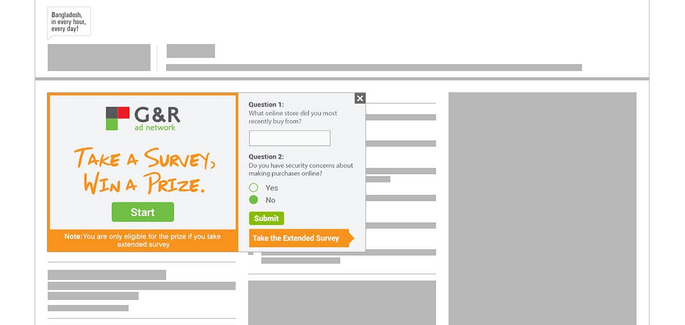

**What is “clickTag”?**

“clickTag” is a way Ad Networks track clicks on an ad banner.

**Why “clickTag”?**

Ad Networks use dynamic URL for click tracking on an ad banner. “clickTag” is the way how Ad Networks communicate with a HTML5 creative and dynamically set the landing page URL of that creative.

**Where to add “clickTag”?**

For traditional static ads, the whole creative is clickable. However, a HTML5 creative is often very dynamic and demands only a part of it to be clickable. In that case, you have to add “clickTag” on that part only.

**How to add “clickTag” in my HTML5 creative?**

To add “clickTag” in a button in your HTML5 creative, add “GNR\_CLICKTAG” class in that element.

If you want to make your whole HTML5 creative clickable (like static creatives), add “GNR\_CLICKTAG” class in the body tag.

> Note: Please do not use “GNR\_CLICKTAG” class in more than one element in a single HTML5 creative.
