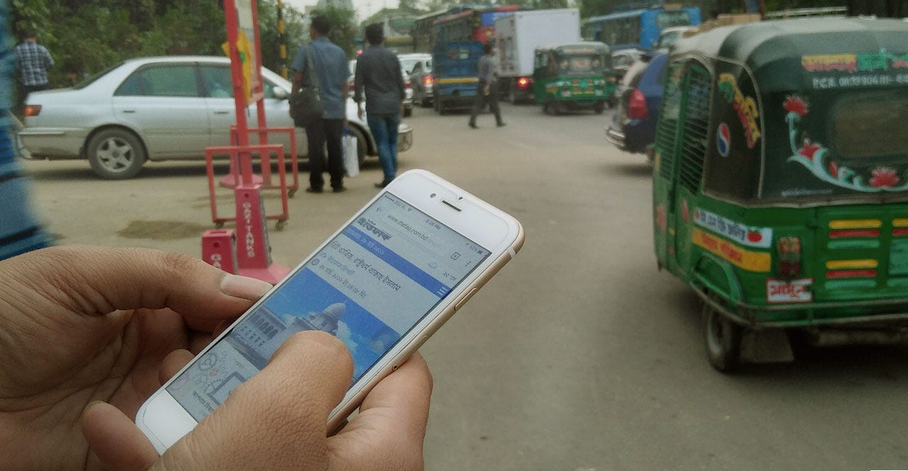
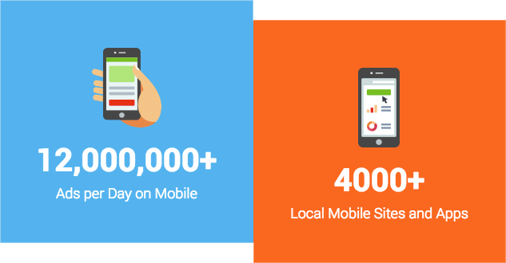
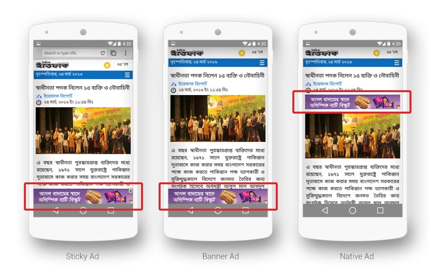
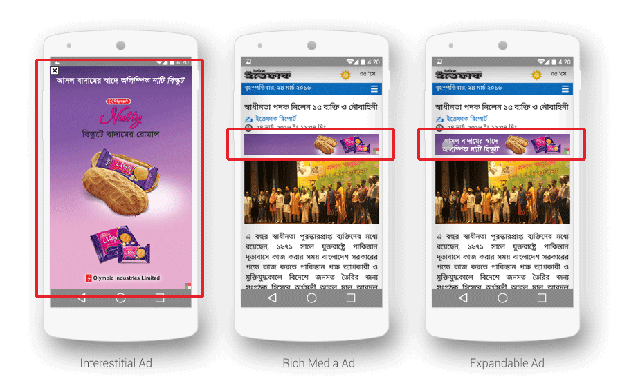

> Grab the fastest growing customer base with Mobile Advertising

Since the introduction of 3G services, the internet has been spreading in Bangladesh at a fascinating speed. By the end of 2014, internet users grew from [35 million](http://www.btrc.gov.bd/content/internet-subscribers-bangladesh-december-2013) to nearly [44 million](http://www.btrc.gov.bd/content/internet-subscribers-bangladesh-december-2014). In 2015, we had [10.5 million](http://www.btrc.gov.bd/content/internet-subscribers-bangladesh-december-2015) additional internet subscribers in Bangladesh. Of the 54 million active internet subscribers, nearly 96% are on mobile and 10 million use smartphones. G&R’s data also says the same. In 2015, our mobile inventory surpassed the desktop inventory.

[G&R](https://www.green-red.com/) is the first and largest ad network in Bangladesh as we’ve been in the business for over 5 years. We are the local Digital Advertising Network in Bangladesh with over 4500+ local websites and apps within our network. Through this robust network, any brand or company can reach up to 20 Million Bangladeshis who browse the internet from both Desktop and Mobile every day.

As a dynamic technology company, mobile was always a prime focus for G&R. We have had great device and network targeting features for the mobile for a long time. Recently, we have strengthened our local [Mobile Advertising Platform](https://www.green-red.com/mobile) even more, to enable advertisers, ad agencies and other online media buyers to acquire quality local mobile traffic.

#### Why G&R Mobile Ads?

No matter whether you have a social media page, website or not; now you can bring new customers with G&R Mobile Ad Network.

**Click to Call:** On devices with phone capabilities, our ads make easy for users to directly call you by simply tapping the ad.

**Click to SMS:** Our ads are designed to make it easier for businesses and customers to connect via SMS or dial a USSD code on mobile.

**Click to Email:** To connect via email on tapping mobile ads, here you find the smartest option for your customers.

> With unique advertising capabilities, our experienced team can help you get your desired result.

#### Ad Types

G&R has different ad types for both mobile web and applications. Besides the traditional **Banner Ads**, there are **Native Ads** for mobile applications which blend inside the content. **Interstitial Ads** allow you to reach your audience in an immersive way. For mobile optimized websites, **Sticky Ads** allow the audiences stick with your ad whether they scroll up or down the page.

> Our data shows that Sticky Ad performance is 60% more than that of traditional one.

**Expandable Ads** help brands communicate more information to the customers in an engaging way.

*Different types of Ads in G&R*

> If you are interested in promoting your mobile application, with our [App Install Tracker (SDK)](https://blog.green-red.com/download-matters-right-5fa1f8066d6), you can increase and monitor the downloads.

#### Targeting

With our state of the art targeting feature, advertisers can target -

-   Any specific city, in or outside Bangladesh
-   Any mobile operator (Robi, GP users etc.)
-   Handset model (Samsung Galaxy S5, iPhone 6 etc.)
-   Operating System (Android, Windows 7 etc.) or
-   Browser (Chrome, UC Browser etc.)

With growing internet connectivity, the availability of cheaper varieties of smartphones, hasty rise in social networking and e-commerce initiatives in Bangladesh, the consumers are getting more and more digitally accustomed. Which clearly shows that advertiser should go mobile first to catch up with these potential customers.

In where **G&R** can make a great way for advertisers.

Co-author: [Md. Saidur Rahman Sagor](https://medium.com/u/3b90702ce13f), Senior Manager, Growth, G&R

Special thanks: [Muhammad Nazimuddaula](https://medium.com/u/346171d82b46), CEO, G&R

* * *

[Go Mobile with G&R](https://medium.com/green-and-red/go-mobile-with-g-r-937707e66678) was originally published in [Think Digital](https://medium.com/green-and-red) on Medium, where people are continuing the conversation by highlighting and responding to this story.
