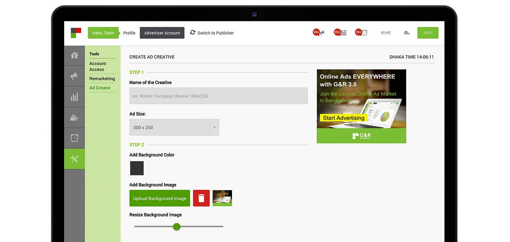

*Ad Creator Tool by G&R*

A beautiful design comes from a beautiful mind. Tools should not be a barrier in the way. If you have a beautiful display ad design in your mind, you should be able to make them with ease.

### What is Ad Creator Tool?

Ad Creator Tool is a tool that will help you turn your beautiful idea into a real ad creative. You can access it from here in G&R Dashboard.

### Why should I use this?

Ad Creator Tool is made for creating ads. There are hundreds of design tools out there which are awesome but made for the professional designers. They are for a wider purpose (not only for ads). Whereas for designing an ad you don’t need all these functionalities. Moreover, most of those design tools are desktop Softwares which need to download and install in your computer.

On the other hand, Ad Creator Tool is a web tool (there is no download and install) which has exactly the right amount of features to create a beautiful ad. It is deeply integrated with G&R Dashboard. So, you can create your ads from the dashboard, save them and use them with your ad campaign very easily.

### Who should use this?

As I’ve already said that, existing design tools out there are hard to figure out and harder to master. If you need a design tool only for creating ad creatives, you definitely don’t need them.

From our G&R experience, we see that many small advertisers want to create an advertiser campaign, they set up their campaign, add budget but get stuck when they are asked to upload their ad creatives. Being small businesses, most of them don’t have a design team or a designer into their team. Ad Creator Tool is intended for these small advertisers.

> “A beautiful design comes from a beautiful mind. Tools should not be a barrier in the way.”

### How does it work?

Ad Creator Tool is surprisingly simple. You can design an awesome creative in just 4 steps.

**Step 1 — Name and Size**

Your creative name should be campaign specific so that when you see the list of the creatives, you can understand which creative is for which campaign. So, your creative name should contain the campaign name, ad size.

For example “Pepsi Winter Campaign - Medium Rectangle - 300x250”

Then you have to select the ad size for which you want to create your creative.

**Step 2 — Background and Logo**

Now you have to choose a background for your creative. You can choose to go with a single color background or upload your own background image.

You can move the background by clicking on the image in the preview and dragging it. You can resize the background from there too or using the slider.

Then you can upload your brand logo to put it into the creative. You can move it around and resize it just like you did for your background image.

> Please note that your logo or symbol has to be a .png file with transparent background.

**Step 3 — Primary and Secondary Text**

You should put some text into the creative so that users can understand about your campaign. Put a short yet intriguing title as your primary text and a small 1 line description of that.

> Note: Don’t put too much text inside your creative. This will drastically reduce the click and engagement of your ad.

For both primary and secondary text, there are options to switch between Bengali and English text. You can choose the font that suits you best from a list of 13 fonts. In the “+ Advanced” section, there are other customization options like text color, text background color, text style (Normal, Bold, Italic), font size and line height. Feel free to play with them.

**Step 4 — Call for Action Button**

The last step is to create a “Call for Action” button. It will ask your users to click on your creative or take an action.

For example “Learn More”, “Buy Now”, “Download Now”, “Sign Up Now” etc.

You can switch between Bengali and English text, change the font, text color and button color. You can also change the text style and font size from the “+ Advanced” section.

> Note: Use a bright color for your “Call for Action” button and make the text bigger, so that it catches the eyes of the users easily.

Congratulations! You are done with your awesome creative. :)

### Can I save my progress and finish it later?

Yes, you can save your work and finish it later. Click on the “Save” button to save your work in the Ad Creator Tool. You can see your saved ads here in the “Draft” tab.

### How can I publish my ad?

Once you are done with editing, click on the “Publish” button to publish your creative. You can see your published ads here in the “Published” tab.

### Can I edit my published ad?

No. Once you publish a creative, you can’t edit it anymore. You can only use them in an ad campaign.

### How can I use that for my campaign?

Go to the Advertiser Dashboard, create campaign then create an ad group inside that campaign and then create an ad. In the “Create Ad” page, you can upload any image (.jpg, .png), animation (.gif), flash (.swf) or HTML5 (.zip) file or you can use any ad that you’ve already published using Ad Creator Tool.

To do that, click “Upload from Ad Creator” from the create ad page. You’ll be shown all your published ads. Click on the ad you want to select and then click the “Select” button. That’s it, you are done.

If you face any problem or have any queries, please email at [a@green-red.com](mailto:a@green-red.com). Happy Advertising!
