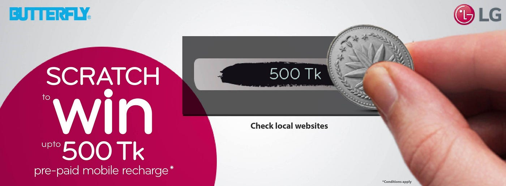

### Background

LG-Butterfly, a well known international electronics brand, also very popular in Bangladesh. Every year on the eve of Eid ul Adha they run a [Scratch Card campaign](https://www.facebook.com/search/top/?q=%E2%80%AA%23%E2%80%8Escratchisgood%E2%80%AC) where anyone who buys any LG-Butterfly products get a discount based on their scratch card. It is one of the most popular campaigns of LG-Butterfly and their customers love it.

However, last August, on the eve of Eid ul Adha, they wished to do something different. Something that no brands ever did in Bangladesh before. They planned to bring that Scratch Card campaign into the digital arena. Adcomm was the Media Agency in charge of the campaign.

### Goal

As this is the first time any brand is doing anything like that, the goal was pretty simple for LG-Butterfly. Their primary goal was to reach as many users as possible online. The idea is to stay on top of the users mind and sending them a reminder about the Scratch Card campaign that is running on their physical outlets.

Another goal of this campaign, like it’s offline part, is to draw a positive attention towards the brand.

### Approach

LG-Butterfly decided to go with a set of HTML5 — Rich Media Creatives where a user can see a scratch card, scratch in the banner and win a random amount of (৳10 to ৳500) mobile recharge (or ‘Try again’). User can then provide his/her phone number in the banner and get that amount in his/her mobile phone immediately.

There were 2 major challenges here.

1.  Reaching a wide range of local audience online
2.  Technical implementation of the interactive creatives for the digital scratch card

Bagher Bachcha Digital of Adcomm and LG Butterfly relied on G&R for both.

*A gif demo of the experience*

G&R, being the largest online Ad Network in Bangladesh, serves 600 million ads per month. For maximum and relevant reach, they decided to target only Bangladeshi audiences in both desktop and mobile.

G&R partnering with SSL Wireless (for instant mobile recharge), prepared the HTML5 — Rich Media creatives for LG-Butterfly. You can see an example creative [here](http://tools.green-red.com/ad-gallery).

### Results

The result was tremendous in terms of reach. These ads were shown 6M times, 2,180 people won a mobile recharge (sorry for the rest) and a handsome amount of leads generated.

> “G&R is constantly seeking clever ways to reach and engage consumers on digital space. G&R’s Ad Network technology helped us discover digital audiences passionate about LG brand. Through this innovative campaign we were able to generate a handsome leads from online.” — M. Nafeezul Bari, Head of Digital, Adcomm

Overall, it was a great experience for both LG-Butterfly and G&R. It gave LG-Butterfly a great exposure and put them in a unique position digitally.

* * *

[LG’s Innovative Digital Scratch Card Campaign to Draw a Positive attention](https://medium.com/green-and-red/lgs-innovative-digital-scratch-card-campaign-to-draw-a-positive-attention-4092275114fe) was originally published in [Think Digital](https://medium.com/green-and-red) on Medium, where people are continuing the conversation by highlighting and responding to this story.
