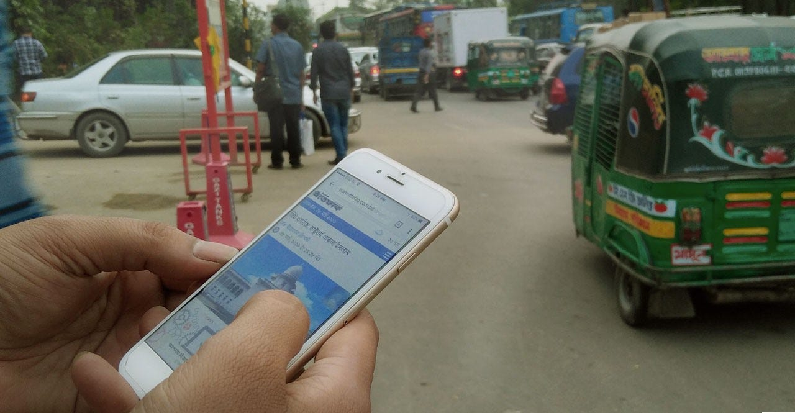
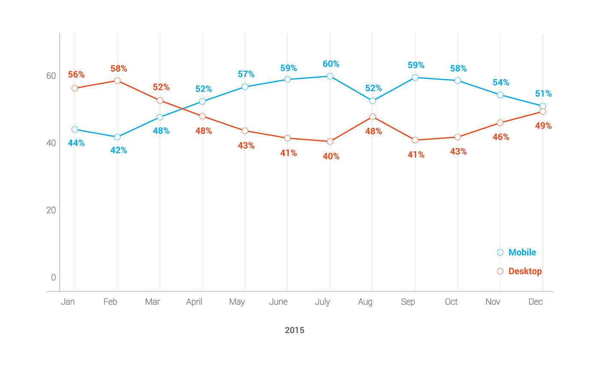
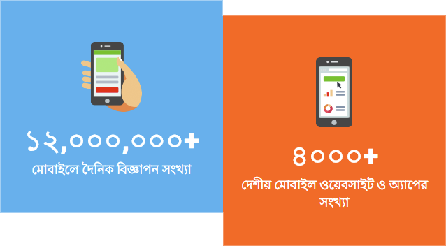

> মোবাইলে বিজ্ঞাপনের মাধ্যমে ক্রমবর্ধমান ক্রেতাদের সাথে থাকুন

3G চালু হওয়ার পর থেকেই বাংলাদেশে ইন্টারনেট ব্যবহারের প্রসার অনেকটাই বেড়ে যায়। ২০১৪-র শেষ নাগাদ ইন্টারনেট ব্যবহারকারীর সংখ্যা [৩ কোটি ৫০ লক্ষ](http://www.btrc.gov.bd/content/internet-subscribers-bangladesh-december-2013) থেকে বেড়ে দাড়ায় প্রায় [৪ কোটি ৪০ লক্ষ](http://www.btrc.gov.bd/content/internet-subscribers-bangladesh-december-2014)। শুধু ২০১৫ সালেই এতে যোগ দেন আরো প্রায়[১ কোটি](http://www.btrc.gov.bd/content/internet-subscribers-bangladesh-december-2015) ব্যবহারকারী। বর্তমানে বাংলাদেশের ৫ কোটি ৪০ লক্ষ ইন্টারনেট ব্যবহারকারীর প্রায় ৯৬%-ই মোবাইল মাধ্যম থেকে ব্যবহার করেন যাদের মধ্যে প্রায় ১ কোটি স্মার্টফোন ব্যবহারকারী। G&R-এর উপাত্তের দিকে তাকালেও আমরা একই চিত্র দেখতে পারি। ২০১৫ সালে আমাদের মোবাইল বিজ্ঞাপনের অনুরোধ ডেস্কটপকে ছাড়িয়ে গেছে।

[G&R](https://www.green-red.com/) বাংলাদেশে প্রথম এবং সর্ববৃহৎ অনলাইন বিজ্ঞাপন নেটওয়ার্ক। আমাদের নেটওয়ার্কে ৪৫০০+ ওয়েবসাইট ও মোবাইল অ্যাপ রয়েছে। এই শক্তিশালী নেটওয়ার্কের মাধ্যমে যে কোন বিজ্ঞাপনদাতা খুব সহজেই প্রতিদিন প্রায় ২ কোটি বাংলাদেশী ইন্টারনেট ব্যবহারকারীর কাছে পৌঁছে যেতে পারেন।

একটি প্রগতিশীল প্রযুক্তি সংস্থা হিসেবে মোবাইল সবসময়ই G&R-এর চিন্তা-ভাবনার কেন্দ্রবিন্দুতে ছিল। মোবাইলের জন্য আমাদের সুনির্দিষ্ট মোবাইলের মডেল বা নেটওয়ার্কে বিজ্ঞাপন পৌঁছানোর ক্ষমতা আছে অনেক দিন ধরেই। সম্প্রতি, আমরা আমাদের [মোবাইল বিজ্ঞাপন নেটওয়ার্ককে](https://www.green-red.com/mobile-bn) আরও শক্তিশালী করেছি। ফলে, বিজ্ঞাপনদাতা বা বিজ্ঞাপন এজেন্সিদের জন্য অনলাইনে সঠিক ব্যবহারকারীর কাছে সঠিক বিজ্ঞাপন পৌঁছে দেয়া আরো সহজ হয়ে গেছে।

#### কেন G&R-এর মোবাইল বিজ্ঞাপন ব্যবহার করবেন?

আপনার ব্যবসার কোনো ওয়েবসাইট অথবা সামাজিক যোগাযোগ মাধ্যমে উপস্থিতি থাকুক বা না থাকুক, G&R-এর মোবাইল বিজ্ঞাপন ব্যবহার করে খুব সহজেই আপনি নতুন ক্রেতাদের কাছে পৌঁছে যেতে পারেন।

**ক্লিক টু কল:** মোবাইলে আমাদের বিজ্ঞাপনে ক্লিক করার মাধ্যমে ব্যবহারকারী কোনো ঝামেলা ছাড়াই সরাসরি আপনার নির্ধারিত নম্বরে কল করতে পারবে।

**ক্লিক টু এসএমএস:** শুধুমাত্র বিজ্ঞাপনে ক্লিক করার মাধ্যমে ব্যবহারকারী কোনো নির্ধারিত নম্বরে এসএমএস বা USSD নম্বরে ডায়াল করতে সমর্থ হবে।

**ক্লিক টু ইমেইল:**এক্ষেত্রে ব্যবহারকারী কোনো নির্ধারিত ইমেইল ঠিকানায় মেইল পাঠাতে পারবে কেবল মাত্র মোবাইল বিজ্ঞাপনে একটি ক্লিক করার মাধ্যমেই।

> আপনার কাঙ্খিত লক্ষ্য অর্জনে আমাদের অভিজ্ঞ বিজ্ঞাপন ব্যবস্থাপকদের সার্বিক সহায়তা তো থাকছেই।

#### **বিজ্ঞাপনের ধরণ**

মোবাইল ওয়েবসাইট এবং অ্যাপের জন্য G&R-এর বিভিন্ন ধরনের বিজ্ঞাপন রয়েছে। গতানুগতিক **ব্যানার বিজ্ঞাপনের**পাশাপাশি মোবাইল অ্যাপের জন্য আছে নেটিভ বিজ্ঞাপন। **নেটিভ বিজ্ঞাপনগুলো** মোবাইল অ্যাপের অন্য সব বিষয়বস্তুর সাথে মিশে থাকে। এছাড়াও মোবাইল অ্যাপের দুইটি স্ক্রিনের মাঝে পূর্ণ স্ক্রিন জুড়ে আসে **ইন্টারস্টিশিয়াল বিজ্ঞাপন**। ব্যবহারকারীদের সাথে সংযুক্ত হওয়ার জন্য এটি অত্যন্ত কার্যকরী মাধ্যম। তাছাড়া ব্যবহারকারীদের বিশেষ দৃষ্টি আকর্ষণের জন্য মোবাইল উপযোগী ওয়েবসাইটে থাকছে **স্টিকি বিজ্ঞাপন** ব্যবস্থা। যা কিনা যেকোনো ওয়েবসাইট পাতার নিচে বা উপরে সবসময় স্থির হয়ে থাকবে।

> আমাদের উপাত্ত অনুযায়ী স্টিকি বিজ্ঞাপন গতানুগতিক বিজ্ঞাপনগুলোর থেকে ৬০% অধিক কার্যকর।

বিজ্ঞাপনের মাধ্যমে ব্যবহারকারীদের কাছে আপনার পণ্য বা ব্যবসা সম্পর্কে বিস্তারিত তুলে ধরার জন্য **এক্সপান্ডেবল বিজ্ঞাপনের** কোন তুলনা হয় না।

***G&R-এর বিভিন্ন ধরনের বিজ্ঞাপন***

> তাছাড়া আমাদের [অ্যাপ ইনস্টল ট্র্যাকার](https://blog.green-red.com/download-matters-right-5fa1f8066d6) *ব্যবহার করে* আপনার মোবাইল অ্যাপের ডাউনলোড সংখ্যা বাড়ানো এবং তা পর্যবেক্ষণ করা সম্ভব।

#### সুনির্দিষ্ট ব্যবহারকারী নির্ধারণ

আমাদের অসাধারণ প্রযুক্তির মাধ্যমে বিজ্ঞাপনদাতারা নিম্নোক্ত বিষয়গুলো সুনির্দিষ্টভাবে নির্ধারণ করতে পারবেন -

-   যে কোনো নির্দিষ্ট শহর, বাংলাদেশের ভেতর বা বাইরে
-   যে কোনো মোবাইল নেটওয়ার্ক (রবি, গ্রামীনফোন ইত্যাদি)
-   যে কোনো মোবাইল মডেল (স্যামসাং গালাক্সি এস৫, আইফোন ৬ ইত্যাদি)
-   অপারেটিং সিস্টেম (এন্ড্রয়েড, উইন্ডোজ ৭ ইত্যাদি) অথবা
-   ব্রাউজার (ক্রোম, ইউসি ব্রাউজার ইত্যাদি)

বর্তমানে বাংলাদেশে যে হারে ইন্টারনেট ব্যবহারকারী বাড়ছে, কমদামী স্মার্টফোন যতটা সহজলভ্য হচ্ছে এবং সামাজিক যোগাযোগ মাধ্যম ও ইকমার্সের যে হারে প্রসার হচ্ছে, তাতেই বোঝা যাচ্ছে যে ভোক্তাদের মাঝে প্রতিনিয়ত মোবাইল নির্ভরতা বেড়েই চলেছে। সুতরাং আগামীর এই ভোক্তাদের কাছে পৌঁছাতে বিজ্ঞাপনদাতাদের অবশ্যই মোবাইলকে অগ্রাধিকার দিয়েই চিন্তা করা উচিত।

এখানেই **G&R** বিজ্ঞাপনদাতাদের পথ দেখাতে পারে।

সহ-রচয়িতা: [মো: সাইদুর রহমান](https://medium.com/@saidur), জ্যেষ্ঠ ব্যবস্থাপক, ক্রমোন্নতি, G&R

বিশেষ ধন্যবাদ: [মোহাম্মদ নাজিমুদ্দৌলা](https://medium.com/@nazimuddaula), প্রধান নির্বাহী কর্মকর্তা, G&R

* * *

[মোবাইলে থাকুন G&R-এর সাথে](https://medium.com/%E0%A6%AA%E0%A7%8D%E0%A6%B0%E0%A6%AF%E0%A7%81%E0%A6%95%E0%A7%8D%E0%A6%A4%E0%A6%BF-%E0%A6%95%E0%A6%A5%E0%A6%A8/%E0%A6%AE%E0%A7%8B%E0%A6%AC%E0%A6%BE%E0%A6%87%E0%A6%B2%E0%A7%87-%E0%A6%A5%E0%A6%BE%E0%A6%95%E0%A7%81%E0%A6%A8-g-r-%E0%A6%8F%E0%A6%B0-%E0%A6%B8%E0%A6%BE%E0%A6%A5%E0%A7%87-597067493830) was originally published in [প্রযুক্তি কথন](https://medium.com/%E0%A6%AA%E0%A7%8D%E0%A6%B0%E0%A6%AF%E0%A7%81%E0%A6%95%E0%A7%8D%E0%A6%A4%E0%A6%BF-%E0%A6%95%E0%A6%A5%E0%A6%A8) on Medium, where people are continuing the conversation by highlighting and responding to this story.
