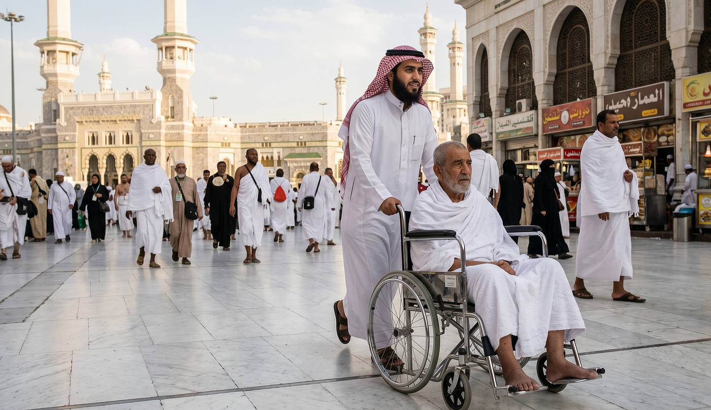

> إِنَّ اللَّهَ يَأْمُرُ بِالْعَدْلِ وَالْإِحْسَانِ وَإِيتَاءِ ذِي الْقُرْبَىٰ وَيَنْهَىٰ عَنِ الْفَحْشَاءِ وَالْمُنكَرِ وَالْبَغْيِ ۚ يَعِظُكُمْ لَعَلَّكُمْ تَذَكَّرُونَ

> “নিশ্চয়ই আল্লাহ ন্যায়বিচার, ইহসান এবং আত্মীয়-স্বজনকে দান করার নির্দেশ দেন, এবং অশ্লীলতা, অন্যায় ও সীমালঙ্ঘন থেকে নিষেধ করেন। তিনি তোমাদেরকে উপদেশ দেন, যাতে তোমরা শিক্ষা গ্রহণ করো।” (সূরা আন-নাহল, ১৬:৯০)

গত শুক্রবার জুমার খুতবাতে খতিব সাহেব এই আয়াতটি নিয়ে কথা বলছিলেন। আয়াতটা শোনার পর থেকেই আমার মাথায় একটা চিন্তা ঘুরতে লাগল। আল্লাহ যখন কোনো কিছু করার “নির্দেশ” দেন, তখন সেটা আর ঐচ্ছিক থাকে না, আমাদের ওপর একটা দায়িত্ব হয়ে যায়। ন্যায়বিচার নিয়ে আমরা সবাই কমবেশি জানি, যদিও বাস্তব জীবনে অনেক সময় আমরা সেটা করি না। কিন্তু “ইহসান” শব্দটা শুনে আমি একটু থমকে গেলাম।

ইহসান মানে শুধু ন্যায্য আচরণ করা না, এটা তার চেয়েও বেশি কিছু। কেউ আপনার সাথে খারাপ ব্যবহার করলে ন্যায়বিচার বলে, আপনার অধিকার আছে একই রকম জবাব দেওয়ার। কিন্তু ইহসান বলে, আপনি সেটা না করে বরং তার সাথে ভালো ব্যবহার করবেন। কেউ আপনার সাথে ভালো করলে, ইহসান বলে আপনি তার চেয়েও ভালো কিছু ফিরিয়ে দেবেন। আর কেউ কিছু না করলেও, শুধু আল্লাহর সন্তুষ্টির জন্য তার জন্য ভালো কিছু করার চেষ্টা করা - এটাই ইহসান।

কুরআনের একাধিক স্থানে মা-বাবার ক্ষেত্রে একই শব্দ “ইহসান” ব্যবহার হয়েছে:

> وَبِالْوَالِدَيْنِ إِحْسَانًا

> “এবং মা-বাবার সাথে ইহসান করো।” (সূরা আল-ইসরা, ১৭:২৩; আরও দেখুন ২:৮৩, ৪:৩৬, ৬:১৫১)

মা-বাবার প্রতি কর্তব্যের গুরুত্ব ইসলামে কত বেশি, এটা আমরা সবাই জানি। অথচ সূরা নাহলের এই আয়াতে একই শব্দ কোনো শর্ত বা সীমাবদ্ধতা ছাড়াই সকল মানুষের ক্ষেত্রে ব্যবহার হয়েছে। অর্থাৎ, ইহসানের যে মূলনীতি - প্রতিদানের হিসাব না করে ভালো কিছু করা - তা মা-বাবার পর্যায়ে না হলেও, একই মূলনীতি সকল মানুষের সাথে আচরণের ক্ষেত্রেও প্রযোজ্য। ইহসান তাই কোনো “অতিরিক্ত” বিষয় নয়, এটাই মুসলিমদের বেসিক স্ট্যান্ডার্ড।

এর কিছু সহজ উদাহরণ - কেউ রূঢ় ভাষায় কথা বললে তার জবাব ভদ্রতা দিয়ে দেওয়া, কেউ ছোট কোনো অন্যায় করলে সেটার প্রতিশোধ না নিয়ে তাকে মাফ করে দেওয়া ও সম্পর্ক ভালো রাখা এবং কোনো বিশেষ কারণ না থাকলেও প্রতিবেশী বা অপরিচিত মানুষের প্রতি সদয় হওয়া।

হজের সফরে এই ইহসান আমি নিজের চোখে দেখেছি। মানুষ অচেনা মানুষের হুইলচেয়ার ঠেলে নিয়ে যাচ্ছে, যাকে সে আগে কখনো দেখেনি। খাবার কিনে রাস্তায় রেখে দিচ্ছে, যাতে যার প্রয়োজন সে এসে নিতে পারে। যার কাছে দেওয়ার মতো বেশি কিছু নেই, সেও তাওয়াফের সময় হাতে একটা টিস্যু বক্স নিয়ে অন্য হাজীদের দিকে টিস্যু বাড়িয়ে দিচ্ছে। আমি বাংলাদেশি ভাইদের মধ্যেও ইহসানের খুব ভালো প্র্যাকটিস দেখেছি। সবার মধ্যেই একটা চেষ্টা ছিল - কীভাবে অন্যের উপকার করা যায়, কীভাবে অন্যের জন্য হজকে সহজ করা যায়।

কিন্তু এই মানসিকতা তো শুধু হজের জন্য নয়। হারামে যে মানসিকতা নিয়ে আমরা অচেনা মানুষের জন্য কিছু করি, দেশে ফিরে নিজের প্রতিবেশী, সহকর্মী বা রাস্তার অচেনা মানুষের জন্যও কি সেই একই মানসিকতা থাকে? আপনি হজে গিয়ে থাকেন কিংবা আগামীতে হয়তো যাবেন, প্রস্তুতি হিসেবে এখনই ইহসানের প্র্যাকটিস শুরু করতে পারেন - নিজের দেশে, নিজের মানুষদের সাথে সুন্দর ব্যবহারের মাধ্যমে।

আল্লাহ আমাদের সবাইকে ন্যায়পরায়ণতা এবং ইহসান - দুটোই আমাদের দৈনন্দিন জীবনে প্রতিষ্ঠা করার তৌফিক দান করুন। আমিন।
