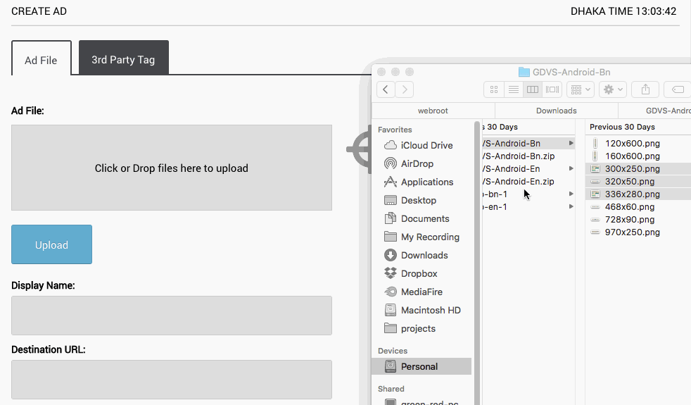

Sometimes managing an online advertising campaign can be exhausting. Specially when you have 10–15 campaigns to manage with hundreds of ad creatives, it can take a lot of time. So today, G&R is introducing 2 new features to make lives easier for our advertisers and agencies.

#### Bulk Uploader

From now, you can upload all your creatives from a single ad group at once. Just drag your creatives on the upload area or click on it and select all your creatives and press the “Upload” button.

*Bulk Ad Uploader*

#### Play/Pause in Ad Group and Campaign level

Playing and pausing a whole ad group or campaign is now possible. If you want to pause a campaign, you don’t need to pause each and every ad in each and every ad group in that campaign. It’s as simple as that.

Hopefully now you can spend less time managing your advertising campaigns and spend more time doing the things you love ❤.

Please continue letting us know your feedbacks.

* * *

[Spend less time managing ads and more time enjoying life](https://medium.com/green-and-red/spend-less-time-managing-ads-and-more-time-enjoying-life-fbd57388146d) was originally published in [Think Digital](https://medium.com/green-and-red) on Medium, where people are continuing the conversation by highlighting and responding to this story.
