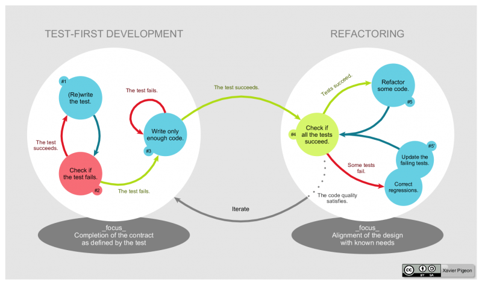
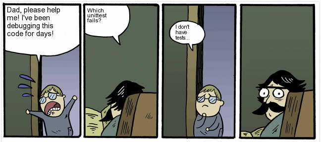
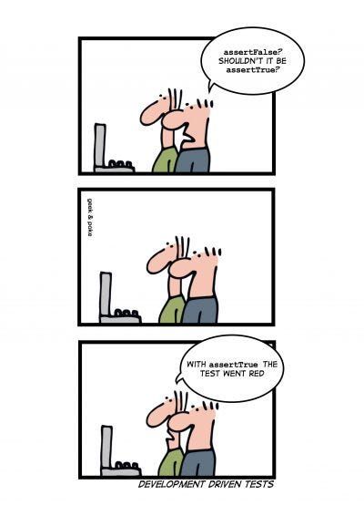
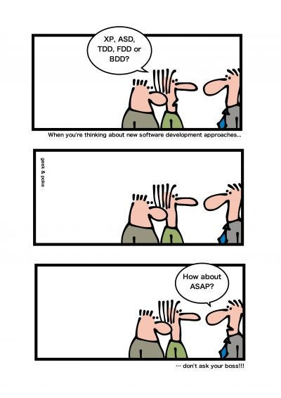

TDD, or Test Driven Development in full, is not a new concept in modern software development practices. However, many software engineers still find it very weird and contrary to common sense. In this brief article, I will try to clarify the TDD concepts and prepare your mindset to start TDD from today.

### What is TDD?

Contrary to popular belief, TDD is not a testing process. It is a design process. It’s a robust way of designing software components interactively, one unit at a time, by making sure that the individual component’s behavior is specified through unit tests beforehand.

There are 3 laws of TDD.

1.  Write a failing unit test for a feature.
2.  Write just enough code needed to pass that failing test. Don’t bother about code quality at this stage.
3.  Refactor your code if possible.

> It is a *“break first, build later”* approach.

### Why TDD?

In TDD, we write only a few lines of code each time to pass a failing unit test. So, our development cycle is very very short, which makes debugging very easy too. How easy would it be to debug, if we could know that our code was just fine a few seconds back?

Developers love to learn about software by reading code. Even when we work with any 3rd party library, we tend to move directly to the code examples. Unit tests do the same for your production code. It makes other developers’ lives easier by being able to understand how your feature should work.

Writing tests after writing the code is hard. As the code can be written without testability in mind, it might not be testable, or properly decoupled/modularized. Hence, we would need to change our code again to make it testable.

Writing tests subsequently after writing code does not bode well, since we already know that our code works. Writing tests before the code can be fun, as the test at first fails, and then we write code to make it pass.

When we write tests after the code, it leaves holes in the test suite, as we are highly likely to miss some corner cases here and there. When we run a test suite full of holes, passing all the tests means nothing at all.

One of the primary reasons for doing TDD is that it makes refactoring a piece of cake. Most of the time we avoid fixing bad code in our project as it might break the system. With TDD, we can be brave about refactoring as we know that the consequences of our changes are just a “run all tests” away.

### Overcoming the challenges in TDD

Like most of the things in life, TDD is easier said than done. There are many challenges in our path. However, the good thing is, they can be overcome.

**TDD seems counter-intuitive. How do I know what to test before I write the code?**

If you think this, you probably like to dive straight into the code when you see a problem. This, unfortunately, is not the right approach. You should start solving a problem by some kind of design on paper or in your head. Once you have the design ready, you know what tests to write. Nobody is saying it is easy. It takes time. Trust me though, it gets easier with practice.

**It’s a waste of time.**

It is true that TDD makes developing the initial version of the code a lengthy process, but it is not a waste. Moreover, if you consider the time for debugging, refactoring, and later understanding the code, then the amount of time you save in TDD is incredible. Remember, there is nothing good about driving fast in the wrong direction

**I have no idea!**

It’s perfectly normal. You might be new to this or you need some hands-on guidance. Find someone around you who has the knowledge and experience with TDD. Let them help you.

**You have no idea what I am going through.**

Said every developer ever. Regardless of what project or technology you are working with, there is a way to do TDD in most cases. TDD might not be applicable if you are writing simple code such as getters/setters, or one-liners or otherwise without any business logic. The idea is to test everything that could possibly break.

### Examples of TDD

I have written another story with an example of TDD in action. You can find it in the link below.

> [Test Driven Development (TDD) by example](https://medium.com/@tahins/test-driven-development-tdd-by-example-ccf34a785233)

That’s about it. My goal was to prepare you mentally for this unorthodox yet extremely useful approach. I hope some of you are convinced about the usefulness of TDD by now.

So, start using TDD before it’s too late, and don’t forget to have fun. Peace 👍.
