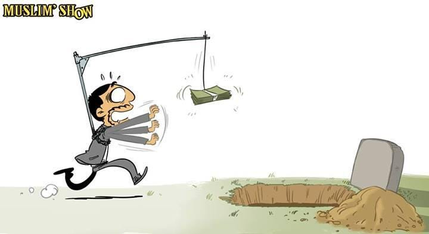

আমরা সাধারণত ছোটবেলায় রচনা লেখার সময়ই প্রথম আমাদের জীবনের লক্ষ্য ঠিক করি। কেউ ডাক্তার, ইঞ্জিনিয়ার হতে চাই। কেউবা হতে চাই বিজ্ঞানী, পাইলট, ব্যবসায়ী আরো কত কি! আসলে ওই বয়সে আমাদের কেউই ওসব হতে চাইতাম না। ওই বয়সে আমরা আসলে চাইতাম খেলাধুলা করতে, আরো বেশি খেলাধুলা করতে। সময় বসে থাকে না। আমরা বড় হই। একসময় শুধু খেলাধুলায় আমাদের মন ভরে না। আমরা চাই আরো বেশি কিছু। আমরা চাই বিনোদন। একটু নাটক-সিনেমা, একটু গান-বাজনা আর একটু আমোদ-প্রমোদ না হলে কি চলে? তারপর একটা সময় আসে যখন নিজেদেরও একটু নায়ক-নায়িকা সাজতে মন চায়। ইচ্ছে করে প্রিয় গায়ক-গায়িকার মত সুর তুলতে, বিপরীত লিঙ্গের দৃষ্টি আকর্ষণ করতে। সময়ের সাথে সাথে নিজের মাঝে একটা হামবড়া ভাব চলে আসে। সবকিছু “আমার” বলে মনে হয়। নিজেকে মনে হয় সবার থেকে একটু “আলাদা”। ততদিনে আমাদের কেউ কেউ তার জীবনের লক্ষ্যে পৌছে যায়। কেউ হয় ডাক্তার, ইঞ্জিনিয়ার, বিজ্ঞানী, পাইলট বা ব্যবসায়ী। আমাদের চাওয়াগুলোও বদলে যায়। আমরা ছুটতে থাকি সম্পদ অর্জনের পিছে। যার যত সম্পদ সে তত সুখী। তারপর একটা সময় সম্পদ নয়, বরং আমাদের সন্তানরাই হয়ে ওঠে আমাদের “সুখ”। আমরা ছুটতে থাকি তাদের পিছে। কিন্তু থেমে থাকে না বয়সের চাকা। একসময় পাক ধরে চুলে। জীবনটা মনে হয় যেন শুকিয়ে হলদে হয়ে যাওয়া খড়কুটো।

পুরো ব্যাপারটা আল্লাহ তায়ালা খুব চমৎকারভাবে বর্ণনা করেছেন আল-কুরআনে,

সূরা হাদিদ \[৫৭:২০\] http://gdvs.co/57/20

মজার ব্যাপার হচ্ছে, আমাদের চাওয়াগুলোর কোনো শেষ নেই। যদি আমরা সেই কাঙ্খিত বস্তু পেয়েও যাই, সেটা কখনই আমাদের জন্য যথেষ্ট হবে না। পরমুহুর্তেই আমরা নতুন কিছুর পিছনে ছুটব। পরিপূর্ণ সন্তুষ্টি কখনই আমাদের মাঝে আসবে না। তাই, চারপাশে তাকালেই আমরা দেখতে পাই আপগ্রেডের জোয়ার। আমাদের ফোন, গাড়ি, বাড়ি, ল্যাপটপ, সবকিছুতেই আমরা খুজি আপগ্রেড, খুজি নতুনত্ব।

আর আমাদের চাওয়াগুলো বেশ দুর্বলও। না পাওয়ার একটা সম্ভাবনা থেকেই যায়। প্রত্যেকবার আমরা কোনো দুর্বলের খোঁজে ছুটি, আমরাও দুর্বল হয়ে যাই। যদি এরকম সীমাহীন অথচ ক্ষনস্থায়ী ও নশ্বর কিছু আমাদের জীবনের উদ্দেশ্য হয়ে দাড়ায় তাহলে আমাদের বেচে থাকাটাই অর্থহীন হয়ে যায়। তাইতো আমরা দেখি খেলাধুলায় হেরে গেলেই, পছন্দের টিভি সিরিয়াল দেখতে না পারলেই, পছন্দের নায়ক-নায়িকার পোশাক কিনে না দিলেই, নিজের থেকে অন্যের অধিক সম্পদ বা গাড়ি-বাড়ি দেখলেই, নিজের সন্তান থেকে অপরের সন্তানকে ভাল রেজাল্ট করতে দেখলেই অনেকের জীবন অর্থহীন হয়ে যায়। তাদের অনেকে আবার জীবন থেকে মুক্তির পথ খোঁজে। কি আশ্চর্য দুর্বল তারা, কি আশ্চর্য দুর্বল তাদের চাওয়াগুলো।

আল্লাহ সুবহানাওয়াতায়ালার ভাষায়,

সূরা হাজ্জ \[২২:৭৩\] http://gdvs.co/22/73

আল্লাহ ছাড়া আর সব কিছুই দুর্বল, ক্ষণস্থায়ী। মহান আল্লাহ তায়ালা আমাদের চাওয়াগুলোকে সৃষ্টি থেকে স্রষ্টামুখী করে দিক আর আমাদের শক্তিশালী করে দিক। আমীন।
